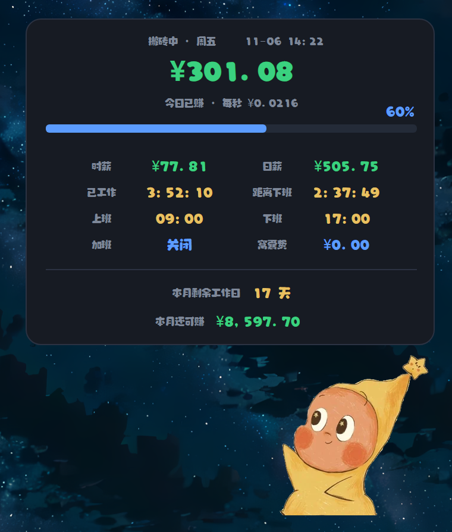
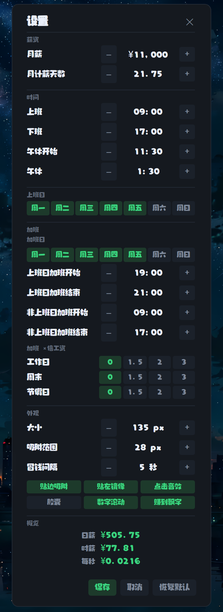

# dsh-star-pet

「上班鼓励宠物」的桌面版插件：一个透明、置顶、可拖动的小星人，实时显示今天赚了多少钱。

和原来的独立 exe 版本画面完全一致（同一批帧、同一套配色与排版），但做成了 **DSH 插件**：

- 跟着 DSH 一起启动，不用单独开程序；
- 右键桌宠 → **设置**，改薪资、上下班时间、午休、外观，即时生效；
- 可以在插件市场里分享给别人（对方装完即用，不需要本地 exe）。

## 截图

展开看板：今日已赚、时薪 / 日薪、下班倒计时、本月剩余工作日。



收起时的桌宠（可拖拽、贴边吸附、按剩余秒数冒「+¥」）：


右键「设置」打开的外观与薪资配置：



## 安装

```bash
dsh plugin add dsh-star-pet        # 或从插件市场点安装
```

首次运行时需要一个 Electron 可执行文件来承载置顶窗口：

| 情况 | 行为 |
| --- | --- |
| 已经装过 `dsh-pet` | 直接复用 `~/.dsh/electron/electron.exe`，零下载 |
| 设了 `DSH_STAR_PET_ELECTRON_PATH` | 用你指定的那个 |
| 都没有 | 设置页会提示，把 Electron 放到 `~/.dsh/electron` 即可 |

## 用法

| 操作 | 结果 |
| --- | --- |
| 单击宠物 | 展开 / 收起今日看板 |
| 按住拖动 | 移动宠物；松手自动贴边（贴左半边时镜像转身） |
| 右键 | 字体、大小、贴边吸附、加班、设置、退出 六项菜单 |
| 悬停 | 显示「困困星人」提示 |

看板内容：工作状态、今日已赚、每秒收入、进度、时薪、日薪、已工作时长、倒计时（加班时显示距加班结束、下班后加班前显示距加班）、上下班时间、**加班时段与当日倍率**、本月剩余工作日、本月还可赚。

状态有五种：搬砖中 / 午休中 / 还没上班 / **休息中**（下班后、加班开始前）/ 加班中 / 已收工 / 今天休息。

## 设置项

- **薪资**：月薪、月计薪天数（日薪 = 月薪 ÷ 月计薪天数）
- **时间**：上班、下班、午休开始、午休时长（只扣落在上下班区间内的午休）
- **上班日**：周一…周日多选
- **加班**：默认关闭，右键菜单可随时开关
  - **加班日自己选**：周一…周日多选，和「上班日」相互独立（默认周一到周五）
  - 加班是**独立时段**，不接下班的时长：上班日走「上班日加班开始 → 结束」，非上班日（周末 / 节假日）走另一对，各自单独配置
  - **加班 ×倍工资**分三行，各自选 **0 / 1.5 / 2 / 3**：工作日默认 **1.5**、周末默认 **2**、节假日默认 **3**
  - 加班收入 = 每秒工资 × 当日倍率 × 加班时长，与正常工时分开累加，滚动在今日已赚之上
  - 下班后到加班开始之间显示「休息中」，倒计时切换为「距离加班」
- **外观**：宠物大小（108–324 px 九档）、贴边吸附范围、冒钱间隔、六个开关（贴边吸附 / 贴左镜像 / 点击音效 / 胶囊 / 数字滚动 / 赚到飘字）

配置保存在 `%APPDATA%\dsh-star-pet\config.json`（macOS/Linux 走各自的配置目录），升级插件不会覆盖。

## 宿主路由

| 方法 | 路径 | 说明 |
| --- | --- | --- |
| GET | `/dsh-star-pet/config` | 读配置 + 宠物进程状态 |
| POST | `/dsh-star-pet/config` | 合并写配置（白名单字段） |
| POST | `/dsh-star-pet/window` | 记住窗口位置 |
| GET | `/dsh-star-pet/pet/state` | 进程是否在跑 / Electron 路径 / 端口 |
| POST | `/dsh-star-pet/pet/start` \| `/pet/stop` | 手动启停 |
| GET | `/dsh-star-pet/assets/*` | 皮肤雪碧图、字体、音效 |

## 说明

- 窗口使用 `transparent + alwaysOnTop('screen-saver') + skipTaskbar`，并默认整窗点击穿透，只有宠物、看板、胶囊区域接收鼠标事件——和 exe 的手感一致。
- Windows 上为了透明分层窗口稳定，会关闭硬件加速（与 dsh-pet 相同做法）。
- 计时全部在渲染进程里算，不依赖系统时钟轮询精度；宿主只负责持久化配置与窗口位置。

## 项目结构

```
dsh-star-pet/
├── package.json              插件清单：版本、dsh.bundle / dsh.client、files 白名单
├── cordis.patch.yml          往 profile 里注册本插件的那一行
├── icon.png                  市场卡片图标（236×256 位图）
├── lib/
│   ├── index.js              宿主侧：/dsh-star-pet 路由、配置读写、拉起 Electron helper
│   └── client.js             浏览器侧：左侧栏图标「困困星人」，点击开关桌宠
├── runtime/helper/           桌宠窗口本体（跑在独立 Electron 进程里）
│   ├── main.js               主进程：透明置顶窗、拖拽、右键菜单、设置窗
│   ├── renderer.js           渲染：看板排版、挤压动画、飘字、计薪计算
│   ├── menu.html / menu.js   右键菜单（按内容自动量高）
│   ├── settings.html / .js   设置窗（306×664，按内容自动定高）
│   └── package.json          {"type":"commonjs"}，覆盖上层的 ESM 声明
├── assets/
│   ├── skins/pet-*.webp      29 帧雪碧图（1× 与 @2× 两套）
│   ├── Ruanti.ttf            软萌体
│   └── click.wav done.wav    点击音效
└── docs/screenshots/         市场详情页截图（由 marketplace 从本 README 提取）
```

- 本机开发时，DSH 通过 `link:` 直接引用这个目录（`~/.dsh/profiles/desktop/package.json`），改完重启桌宠即可生效；
- 发给别人用的是 `dsh-star-pet.tgz`（`files` 白名单打包，`docs/` 不进包）。

## 离线分享（U 盘 / 内网）

不需要 GitHub，也不需要网络，三样东西拷到 U 盘：

| 文件 | 必需 | 说明 |
|---|---|---|
| `dsh-star-pet.tgz` | ✅ | 插件本体，约 5.7 MB |
| `electron-v43.3.0-win32-x64.zip` | 建议 | 约 110 MB；对方机器没有 `~/.dsh/electron` 且不能联网时需要 |
| 本说明 | — | 复制本节即可 |

对方的操作：

1. 把 `dsh-star-pet.tgz` 拷到任意目录，例如 `D:\pet\dsh-star-pet.tgz`；
2. 打开 DSH，在任意会话里说：**安装这个插件：D:\pet\dsh-star-pet.tgz**（agent 会调用 `plugin_manager install_bundle`）；
3. 如果桌宠没出现，把 `electron-v43.3.0-win32-x64.zip` 解压到 `C:\Users\<用户名>\.dsh\electron\`，确认里面直接就是 `electron.exe`，再点侧栏图标。

联网时第 3 步可以省略：插件首次启动会自动从 npmmirror 下载 Electron（约 100 MB，只需一次）。
